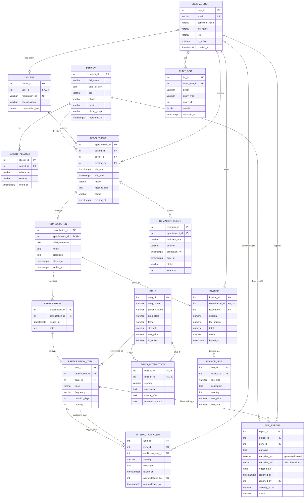

# Nidaan Entity–Relationship Diagram

This diagram follows the 16 tables and foreign keys in `db/01_schema.sql`.
The Mermaid relationship endpoints reflect the actual foreign-key optionality
and uniqueness constraints in that file.

